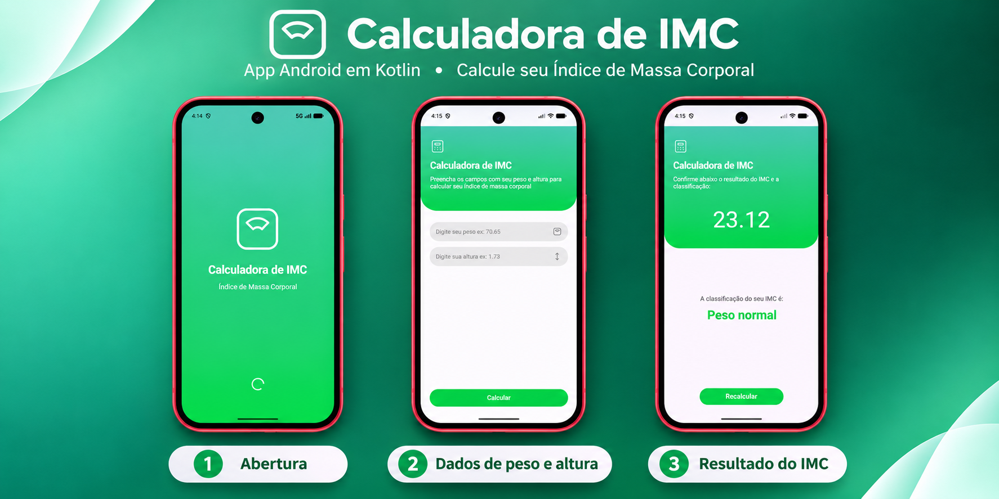

<h1 align="center"> IMCalculator </h1>

<p align="center">
An Android Body Mass Index (BMI) calculator built with Kotlin and XML. <br/>
</p>

<p align="center">
  <a href="https://github.com/GustavoFSCode/IMCalculator/actions/workflows/android.yml"></a>
  <a href="LICENSE"></a>
</p>

<br>

<p align="center">
  
</p>

## 🚀 Technologies

This project was developed with the following technologies and tools:

- Kotlin
- XML
- Android SDK
- Material Components
- Gradle
- Android Studio

## 💻 Project

**IMCalculator** is an Android application that calculates Body Mass Index (BMI) from weight in kilograms and height in meters.

After a welcome screen, users enter their measurements and receive their BMI, displayed to two decimal places, along with a weight classification. The app also lets users return to the calculation screen with empty fields to perform a new calculation.

The project was developed to practice Android development with **Kotlin** and interface design with **XML**.

### Features and applied concepts

- **Welcome screen:** a gradient background and a brief transition to the calculation screen.
- **Input validation:** checks for empty, invalid, or non-positive values, with support for decimal commas and decimal points.
- **BMI calculation:** weight in kilograms divided by the square of height in meters.
- **Result screen:** BMI formatted to two decimal places and a classification with color feedback.
- **New calculation:** a Recalculate button returns to the previous screen with the weight and height fields cleared.
- **Screen navigation:** Activities and Intents handle navigation and pass the calculated BMI between screens.
- **XML interface:** ConstraintLayout, rounded input fields, vector icons, gradient backgrounds, and Material Components.

## ▶️ Running the project

### Input units and example

Enter weight in **kilograms (kg)** and height in **meters (m)**, not centimeters. Decimal commas and decimal points are accepted.

For example, `70` kg and `1.75` m produce a BMI of approximately **22.86 kg/m²**, classified as **Normal weight**. The decimal separator displayed by the app follows the device locale. The app interface is currently in Portuguese.

### BMI classification and limitations

The app uses the following adult BMI ranges. Classification uses the full calculated value before rounding it for display.

| BMI (kg/m²) | Classification |
| --- | --- |
| Below 18.5 | Underweight |
| 18.5 to below 25 | Normal weight |
| 25 to below 30 | Overweight |
| 30 to below 35 | Obesity class I |
| 35 to below 40 | Obesity class II |
| 40 or higher | Obesity class III |

References: [WHO adult BMI definitions](https://apps.who.int/nutrition/landscape/help.aspx?helpid=420&menu=0), [WHO obesity classes](https://gateway.euro.who.int/en/indicators/mn_survey_46-recommendations-on-weight-gain-include-guidance-for-each-obese-class/).

This educational application uses general adult BMI categories. It does not implement age- and sex-specific assessment for children or adolescents, or adjustments for pregnancy or body composition. BMI alone is not a diagnosis or a substitute for an individual assessment by a qualified healthcare professional. See [WHO's overview](https://www.who.int/news-room/fact-sheets/detail/obesity-and-overweight) for context.

### Prerequisites

- [Git](https://git-scm.com/)
- Android Studio compatible with the project's Gradle and Android Gradle Plugin versions
- Android SDK Platform 37
- JDK 25 for the Gradle daemon, as configured in `gradle/gradle-daemon-jvm.properties`
- An emulator or physical device running Android 7.0 (API 24) or later

### Cloning the repository

```bash
git clone https://github.com/GustavoFSCode/IMCalculator.git
cd IMCalculator
```

### Running with Android Studio

1. Open the `IMCalculator` folder in Android Studio.
2. Wait for Gradle sync to finish and install any requested SDK components.
3. Create and start an emulator in **Device Manager**, or connect a physical device with **USB debugging** enabled.
4. Select the device and click **Run ▶**.

### Running from the terminal

With the JDK and Android SDK configured and an emulator running or a device connected, run the following command from the project root:

**Windows — PowerShell:**

```powershell
.\gradlew.bat installDebug
```

**Linux or macOS:**

```bash
chmod +x gradlew
./gradlew installDebug
```

After installation, open **IMCalculator** from the device's app list.

You can also run these commands in the VS Code or Cursor terminal, provided your Android environment is configured.

## 🧪 Tests and continuous integration

Run the local JVM unit tests and build the debug APK:

**Windows — PowerShell:**

```powershell
.\gradlew.bat testDebugUnitTest assembleDebug
```

**Linux or macOS:**

```bash
bash ./gradlew testDebugUnitTest assembleDebug
```

The BMI unit tests cover the formula, values immediately below and above every category boundary, exact boundaries, and invalid or non-finite measurements. They do not automate the UI or emulator navigation. Reports are generated in `app/build/reports/tests/testDebugUnitTest/index.html`.

The [Android CI workflow](.github/workflows/android.yml) runs these checks on pushes to `master`, pull requests, version tags, and manual dispatch. A successful run uploads the demo APK, its SHA-256 checksum, and test reports. The status badge reflects GitHub Actions results once the workflow is published and runs.

## 📦 Demo APK

Download the `IMCalculator-demo` artifact from a successful run on the [Actions page](https://github.com/GustavoFSCode/IMCalculator/actions/workflows/android.yml). Artifact downloads may require signing in to GitHub.

Version-tagged builds also publish the APK and checksum to [GitHub Releases](https://github.com/GustavoFSCode/IMCalculator/releases). A public version appears there only after its tag has been pushed and the workflow succeeds.

To publish a version, first commit and push the intended changes, then create and push an unused version tag, for example:

```bash
git tag v1.0.0
git push origin v1.0.0
```

Extract the artifact ZIP when downloading from Actions, transfer `IMCalculator-demo.apk` to an Android 7.0+ device, and open it to install. Android may ask you to allow installation from that source. This is a debug-signed demonstration package, not a Play Store release; builds from different machines may require uninstalling the previous demo before installation.

To build the APK locally, run `assembleDebug`. The resulting file is `app/build/outputs/apk/debug/app-debug.apk`.

## 👤 Author

Developed by [GustavoFSCode](https://github.com/GustavoFSCode).

## 📄 License

This project is licensed under the [MIT License](LICENSE). Dependency licenses remain applicable to their respective components.
